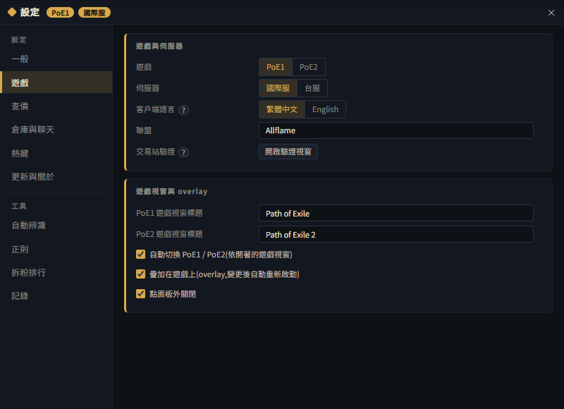
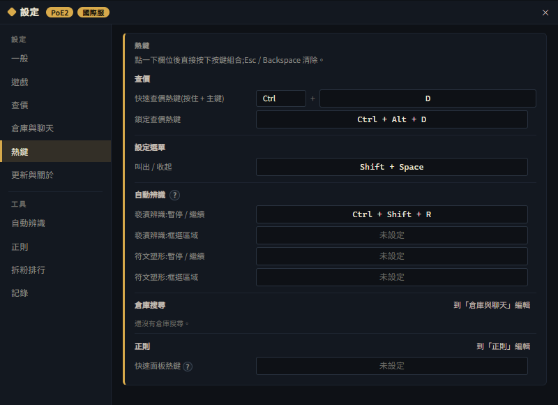
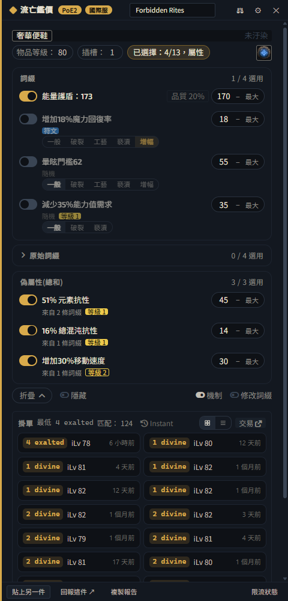
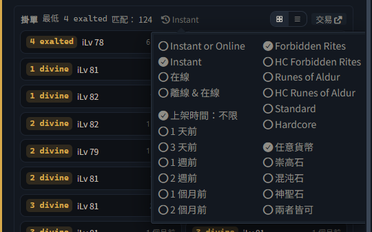
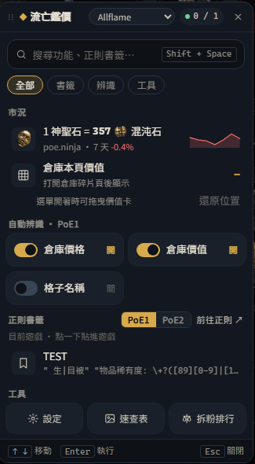
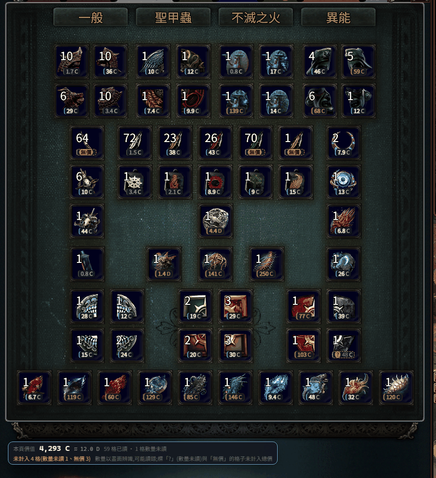
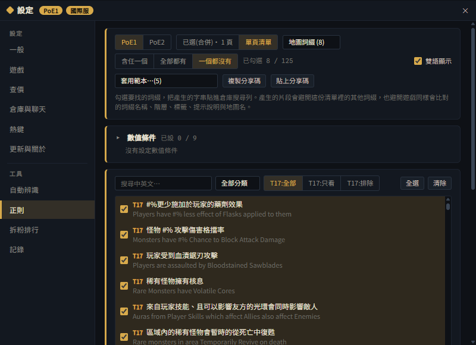
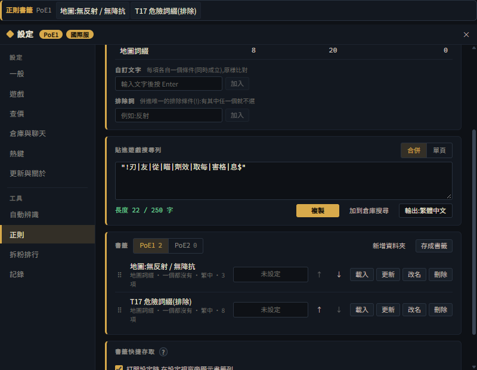
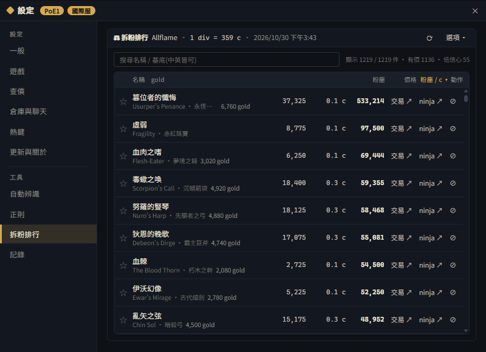

# ExileAppraiser

**English** | [繁體中文](README.md)

A price checker for Path of Exile 1 and 2: hover an item in game, press a hotkey, and listings from the official trade site pop up next to your cursor. Works with the international and Taiwan realms, and with Traditional Chinese or English game clients. It also comes with in-game helpers: a floating menu, regex bookmarks, stash prices and screen recognition.

> Formerly named `poe-price-zh`; settings from the old version are migrated automatically on first launch.

## Download

**Windows only.** Get the files from the **[latest release](https://github.com/Hsiung-Shao/exile-appraiser/releases/latest)**:

| File | What it is |
|---|---|
| `ExileAppraiser-Setup-<version>.exe` | **Installer — recommended.** By default installs for the current user into your user folder, needs no administrator rights, and creates shortcuts (you can also choose the install location). **Only the installed version updates itself**: new versions download in the background and are applied when you quit the app; you can turn this off in Settings › Updates & about. |
| `ExileAppraiser-<version>-portable.exe` | Portable build; just double-click to run. **Does not update itself**; Settings › Updates & about tells you when a new version is out, and "Open Releases" takes you to the download page. |
| `ExileAppraiser-Setup-<version>.exe.blockmap` | Used by the auto-updater (delta download: only the changed parts are fetched). **You don't need to download it.** |
| `latest.yml` | Used by the auto-updater (version info and file hash check). **You don't need to download it.** |
| Source code (zip / tar.gz) | Source archive added automatically by GitHub. Not needed to use the app. |

**Windows SmartScreen**: the app is not code-signed, so the first launch may show "Windows protected your PC". If you downloaded the file from the Releases page above, click **More info → Run anyway**.

## Contents

- [Features](#features)
- [Getting started](#getting-started)
  - [1. First launch](#1-first-launch)
  - [2. Basic settings](#2-basic-settings)
  - [3. Price checking](#3-price-checking)
  - [4. Reading the price panel](#4-reading-the-price-panel)
- [Feature guides](#feature-guides)
  - [Floating menu](#floating-menu)
  - [Stash prices and stash value (PoE1)](#stash-prices-and-stash-value-poe1)
  - [Well of Souls reveal OCR (PoE2)](#well-of-souls-reveal-ocr-poe2)
  - [Runeshape auto price check (PoE2)](#runeshape-auto-price-check-poe2)
  - [Poe Regex search strings and bookmarks](#poe-regex-search-strings-and-bookmarks)
  - [Disenchant ranking (PoE1)](#disenchant-ranking-poe1)
  - [Chat commands, stash search and stash tab scrolling](#chat-commands-stash-search-and-stash-tab-scrolling)
  - [Browser preview of settings](#browser-preview-of-settings)
- [FAQ](#faq)
- [Privacy](#privacy)
- [Support and community](#support-and-community)
- [License and credits](#license-and-credits)

## Features

**Price checking**

- **PoE1 and PoE2 in one app**: switches automatically based on which game window is open.
- **International and Taiwan realms**: both trade sites are supported; on the international realm the language (Chinese or English) is detected from the copied text, so switching the game language just works.
- **In-game overlay price check**: the panel appears over the game next to your cursor; a standalone window mode is also available.
- **Price panel**: mods and pseudo stats sit on two cards with switches and range pills; mods absorbed into totals are listed on a separate "Raw mods" card; each mod can be given a mechanism (Any / Regular / Fractured / Crafted, plus Desecrated / Augment in PoE2).
- **Listings**: switch between grid and list views; hover a listing to see the whole item (with the Chinese interface on the international realm, mods are shown in Traditional Chinese); choices in the listing card's "Online" menu (offline, merchant only, listed time, currency) are remembered.
- **Currency price area**: when checking currency, the top of the panel shows the poe.ninja exchange rate, 7-day trend and hourly volume, and totals up your stack.
- **Related items**: checking boss fragments and similar items lists the rest of the set and the uniques / divination cards they lead to, with prices (international realm).
- **Unidentified uniques**: the possible uniques are listed for you to pick before searching.
- **PoE2 desecrated mod tiers**: shows the tier reported by the game; when only plain copied text is available, the tier is inferred from PoB2 mod data and marked as inferred.
- **Disenchanting (PoE1)**: the price panel shows how much Thaumaturgic Dust a unique yields, plus a ranking of dust efficiency across all uniques.

**In-game tools**

- **Floating menu**: press `Shift + Space` for exchange rates, the stash tab value, auto-recognition switches, regex bookmarks, a cheat sheet and Settings in one place.
- **Poe Regex search string builder**: tick mods / names / values to build a string for the in-game search bar; supports combining pages, share codes and templates; bookmarks can go into folders, get hotkeys and be pasted into the game with one click.
- **Chat command and stash search hotkeys**: one key types chat commands such as `/hideout` or `@last ty`, or a saved string into the stash search box; hold `Ctrl` and scroll to switch stash tabs.

**Screen recognition (OCR, runs locally)**

- **PoE1 stash prices and stash value**: on the "General" and "Scarab" sub-tabs of the fragment stash tab, every cell gets a poe.ninja price, and stack sizes are read to total the tab (international realm).
- **PoE2 Well of Souls reveal OCR**: open the reveal panel and it is recognized automatically; each option is labelled with the tier, mod pool and value range of its desecrated mods.
- **PoE2 runeshape auto price check**: while the runeshape panel is open, each row gets a reference price; rows without a poe.ninja price are looked up on the trade site automatically.

**Interface and upkeep**

- **Separate interface language** (中文 / English), independent of the client language; four themes, accent colour and font size, with a separate font size for the Settings window; your own background image for the price panel and settings window (brightness, panel opacity, frosted blur and position are adjustable).
- **Browser preview of settings**: view and edit settings in a normal browser; changes sync back to the overlay instantly.
- **Automatic updates and update reminders**: the installed version downloads updates in the background and applies them when you quit; later updates only download what changed. A reminder appears at the bottom right while a new version is waiting, and you can skip a version.
- **Startup notice**: a short "running in the background" notice with your price-check hotkey appears at the bottom right after launch, and shows the new version after an update.
- **One-click report**: report buttons sit next to unrecognized mods and in price-check error boxes; a GitHub issue draft is prepared for you to review and submit yourself.
- **Log page**: Settings › Log shows the app's log directly (filter by errors / OCR / price check / hotkeys, keyword search, copy) and can record performance data for bug reports.
- **Anonymous queries**: no login and no POESESSID required.

## Getting started

### 1. First launch

- The app runs in the background with no main window. A notice at the bottom right of the screen briefly shows that it is running, together with the price-check hotkey (can be turned off in Settings › General).
- The app icon lives in the **system tray** (bottom right of the taskbar). Its right-click menu has only: Open settings in browser, the version (greyed out, not clickable), Check for updates, Quit; double-click the icon to bring up the settings window.
- Ways to open Settings:
  - double-click the tray icon (or right-click → "Open settings in browser" to use a browser);
  - in game, with no price panel open, press **`Shift + Space`** to bring up the [floating menu](#floating-menu) and click "Settings";
  - the gear ⚙ in the price panel's title bar.
- The menu on the left of the Settings window has two groups:

| Group | Tab | What's in it |
|---|---|---|
| Settings | General | Interface language, theme, font size, background image, startup notice, hardware acceleration, browser preview |
| | Game | Game, realm, client language, league, trade site check, game window titles, auto-switch, overlay mode |
| | Price check | Stat value tolerance, default price currency, panel display, listings & clipboard |
| | Stash & chat | Stash search, stash tab scrolling, chat commands |
| | Hotkeys | Every hotkey in one table (duplicates and keys taken by other programs are flagged right away) |
| | Updates & about | Automatic updates, update reminders, open config folder, supported game versions |
| Tools | Auto recognition | Shared OCR settings, stash prices (PoE1), desecrated mods / runeshape (PoE2), badge appearance |
| | Regex | Poe Regex search string builder and bookmarks |
| | Disenchant ranking | Dust efficiency of every unique (PoE1) |
| | Log | App log and performance recording |

### 2. Basic settings

In **Settings › Game**:

1. **Game**: PoE1 / PoE2. By default the app switches automatically based on which game window is open ("Auto-switch PoE1 / PoE2" on the same tab): it switches when the current game is not open but the other one is, and stays put when both are open.
2. **Realm**: international (`pathofexile.com`) or Taiwan (`pathofexile.tw`). The Taiwan realm currently supports the Traditional Chinese client only.
3. **Client language**: whether your **game** runs in Traditional Chinese or English. On **International**, price checks detect the language from the copied text automatically (switching the game to the other language just works, with the same results), so this setting is only the default; **Taiwan** always uses this setting (Taiwan supports Traditional Chinese only, and the wrong choice makes parsing fail). The OCR recognition language (stash / desecration / runeshape) also follows it by default.
4. **League**: the league to price check in (you can also switch it from the price panel's title bar and the floating menu). If the list does not load, click "Open check window" under "Trade site check" on the same tab and complete the Cloudflare check once in the window that opens.

The app's own display language (繁體中文 / English) is "Interface language" in **Settings › General**; the screenshots in this README show the Chinese interface. Changes are saved automatically.

### 3. Price checking

Default hotkeys (all changeable in **Settings › Hotkeys**: click a field and press the new combination; `Esc` / `Backspace` clears it):

| Hotkey | Default | What it does |
|---|---|---|
| Quick check | `Ctrl + D` | Hold `Ctrl` and press `D`; the panel appears next to your cursor. **Keep holding `Ctrl`** and move the mouse into the panel to use it; after releasing `Ctrl`, moving the mouse away closes the panel. |
| Locked check | `Ctrl + Alt + D` | The panel is clickable right away and does not close when you move the mouse — good for adjusting filters. |
| Settings menu | `Shift + Space` | With a price panel open, moves focus between the game and the overlay; with no price panel, shows / hides the [floating menu](#floating-menu). |
| Desecration: pause / resume | `Ctrl + Shift + R` | Pauses and resumes PoE2 Well of Souls auto-recognition. |

The desecration select-area, runeshape, stash prices and regex quick panel hotkeys are unset by default; assign them on the same tab when you need them. Hotkeys for individual bookmarks and stash search are set on the Regex and Stash & chat tabs; this tab only lists them and jumps there when clicked. Unset hotkeys are shown in grey; red means a conflict or a key that could not be registered.

Steps:

1. With the game window in front, hover an item and press the price-check hotkey. The app sends the copy keys for you to read the item text:
   - **PoE1**: sends `Ctrl + C`.
   - **PoE2**: sends `Ctrl + Alt + C` (advanced copy), which is needed to get the desecrated mod tiers from the game. The game's default `Alt` is assumed as the "show advanced description" key; a remapped key is not supported yet.
2. The panel lists the item's mod filters: **tick** the mods to include in the search and adjust value ranges (the default tolerance is in Settings › Price check). Magic / rare weapons, armour, jewellery and quivers search for the same base type by default; click the item name to widen it to the whole category.
3. Uniques, currency and similar items are searched immediately; for other items, adjust the filters and click **Search**.
4. To see the full results on the web, click **Trade** to open the same search in your system browser.

> You can also paste manually: when the panel has no item (or after clicking "Paste another"), paste the item text (what `Ctrl + C` copies in game) and click "Parse".

### 4. Reading the price panel

- **Mod / pseudo cards**: a switch decides whether each mod is part of the search; the range pill sets the minimum and maximum.
- **Raw mods card**: mods absorbed into pseudo stats or armour / evasion totals, and rune mods, are listed here, collapsed and unticked by default; expand and tick one when you want to search for it on its own.
- **Mod mechanism**: turn on the "Mechanism" switch at the bottom of the panel to show mechanism buttons under the mods that have them (while it is off, only mods whose mechanism you changed show them):
  - **Any** (default): the mod counts whether it is regular, fractured or crafted.
  - **Regular**: excludes items where this mod comes from its own mechanism (e.g. for a crafted mod, Regular skips items whose copy of this mod is crafted).
  - **Fractured / Crafted** (plus **Desecrated / Augment** in PoE2): only items where this mod has that same mechanism.
- **Currency price area**: when checking currency, the top shows the poe.ninja exchange rate, 7-day trend and hourly volume (international realm); valuable bases are tagged "Base item".
- **Listings**: "Grid / List" in the card's title bar switches the layout, remembered separately for items and currency. Hover a listing to see the whole item ("Settings › Price check › Show item on hover": Off / SHIFT + hover / Always on hover).
- **Related items**: checking boss fragments and similar items lists the rest of the set and the uniques, divination cards and other items they lead to, with prices (international realm; the size is set in Settings › Price check).
- **Unidentified uniques**: the possible uniques are listed for you to pick first (picked automatically when there is only one), then the search runs.
- **Reporting problems**: unrecognized mods have a "Report this" button, and a line above the mod list tells you how many mods were not recognized; failed searches and items that cannot be parsed have a report button too. The app prepares a GitHub issue draft (never sent automatically, no account name included). You can also click "Copy filtered lines" in **Settings › Log** and paste the relevant lines into the issue.

**The listing card's "Online" menu**

Hover the button in the listing card's title bar that shows the current listing condition (for example "Online" in PoE1, "Instant" in PoE2) to open the menu, where you can change:

- **Listing condition**: "Offline & Online" and "Merchant Only" in PoE1; in PoE2 a single listing type (Instant or Online / Instant / Online / Offline & Online), remembered separately for normal and bulk searches
- **Listed time** (Listed: Any Time up to 2 Months Ago)
- **Currency** (Any Currency / Chaos Orb / Divine Orb / Both Orbs; PoE2 also has Exalted Orbs)

These choices are **remembered automatically**: the next item and the next app launch use your last choice (in PoE1 the currency is also synced to "Settings › Price check › Default price currency"). The league is not remembered; it always follows the title bar. If you pick "Offline & Online" or a short listed time, it stays that way, so remember to change it back when you no longer need it.

More options in **Settings › Price check**: stat value tolerance, default price currency (PoE1 only), API latency compensation, currency volume per hour (international realm), related items size, show item on hover, show seller, account name (marks your own listings; optional), and restore clipboard after check.

## Feature guides

### Floating menu

In overlay mode, with no price panel open in game, press **`Shift + Space`** and the floating menu appears:

- **Title bar**: switch league and see the trade site rate-limit status; drag the title bar to move the menu, and its position is remembered.
- **Search box and filters**: type to find a feature or bookmark; the filters are All / Bookmarks / Recognition / Tools; `↑` `↓` select and `Enter` runs.
- **Market**: 1 Divine Orb in Chaos Orbs (PoE1) / Exalted Orbs (PoE2) with a 7-day trend (international realm; data appears after your first price check).
- **Stash tab value** (PoE1): the total of the open fragment stash tab; while the menu is open you can drag the value card on screen, and "Reset position" puts it back.
- **Auto-recognition switches**: stash prices (PoE1) or desecration / runeshape (PoE2), depending on the current game.
- **Regex bookmarks**: switch between PoE1 / PoE2, grouped by folder, with each string shown; bookmarks of the current game paste into the game's search bar with one click, those of the other game are only copied.
- **Tools**: Settings, cheat sheet, disenchant ranking.
- **Cheat sheet**: a built-in Syndicate cheat sheet; hover to enlarge, click to pin (a pinned sheet can be moved and resized). You can also "Import my own…" or go back with "Use built-in".

Close it with ✕, a click outside, `Esc` or `Shift + Space` again; it also closes when a price panel appears.

### Stash prices and stash value (PoE1)

When the **fragment stash tab** is open on its "General" or "Scarab" sub-tab, every cell gets a poe.ninja price (C = Chaos Orb, D = Divine Orb); hovering a cell enlarges just that one.

**Requirements**: PoE1, overlay mode, international realm (poe.ninja has no Taiwan prices, so stash prices are not shown there). Settings are in **Settings › Auto recognition › Stash prices (PoE1 fragment tab)**; on by default.

- **Stash value**: stack sizes are read from each cell, badges show the subtotal, and a "Tab value" card shows the total. Cells whose count could not be read are marked "?" and cells without a price are marked "N/A"; neither counts toward the total. Counts come from screen recognition and can be wrong; the game is always right.
- **Show prices**: "Detect automatically" (appears whenever the stash is open) or "On hotkey" (no screenshots at all until you press the "Stash prices: start / pause" hotkey; hides itself when the stash closes). Set the hotkey in Settings › Hotkeys.
- **Show item names on badges**: lets you check that each cell was recognized as the right item; turn it off afterwards to keep only prices.
- **OCR region**: the app looks here for the row of sub-tab buttons ("General / Scarab …") to tell that the fragment tab is open and which sub-tab is showing; if badges do not appear (for example after you set a custom area and then move the stash tab into a folder, which pushes the buttons down; the default area follows them automatically), select that button row on the game screen again, or "Reset to default". Cell positions follow a fixed layout and are not affected by this.
- Badge font, size and price-tier colours are under "Badge appearance" on the same tab.

### Well of Souls reveal OCR (PoE2)

The Well of Souls three-option reveal panel cannot be copied as text, so the app reads the screen with Windows' built-in text recognition (OCR).

**Requirements**: PoE2, overlay mode, a **Traditional Chinese or English game client**, and the matching Windows OCR language pack: **Chinese (Traditional, Taiwan) / zh-Hant-TW** for the Traditional Chinese client, **English (United States) / en-US** for the English client. The recognition language follows the client language by default; with a Chinese UI and an English game you can set "Recognition language" to English under the shared settings of Settings › Auto recognition (independent of the UI and client languages; shared by stash prices, desecration and runeshape).

**Install the OCR language pack** (once; English Windows usually has the English pack built in):

1. Windows Settings → **Time & language** → **Language & region**.
2. Next to "Chinese (Traditional, Taiwan)" (English client: "English (United States)") click **⋯ → Language options** (add the language first with "Add a language" if it is not listed).
3. Under "Optical character recognition" click **Download**.
4. Back in the app, the shared settings of **Settings › Auto recognition** should show "OCR status: Available (zh-Hant-TW)" or "Available (en-US)" (click "Check again" if needed).

**Usage**:

1. Open the Well of Souls reveal screen; it is recognized automatically (on by default, can be turned off in Settings › Auto recognition › Desecrated modifiers).
2. Each option gets a badge on its right: `Tier · mod pool · value range`, also while the price panel is open.
3. Badges disappear when the reveal panel closes. **`Ctrl + Shift + R`** pauses / resumes auto-recognition (a notice at the bottom right shows the new state).

- A **"?"** on a badge means you have not price checked this item in the last 10 minutes, so the base type is unknown and tiers are inferred from the bases common to all three options. **Price check the item once before opening the reveal panel** for exact results.
- **Recognition area (optional)**: in Settings › Auto recognition › Desecrated modifiers, click "Select on game screen" and drag a box around the reveal panel on the game screen; `Enter` confirms, `Esc` cancels. With an area set, only that area is read (faster and more accurate); if the panel is not found there, the status says so — select again or clear the area.
- **Settings** (the stash, desecration and runeshape cards offer the same items): enable, current status, scan interval (1000 ms by default, 100–3000; below 500 ms costs noticeably more CPU), recognition area; desecration also has "List every possible modifier when an option has several".

### Runeshape auto price check (PoE2)

While the runeshape panel is open, the app periodically reads the panel and shows a poe.ninja reference price to the right of each row. It only takes screenshots and runs OCR locally; no keys are sent.

**Requirements**: PoE2, overlay mode, a Traditional Chinese or English game client, and the matching OCR language pack (see above). poe.ninja reference prices are **international realm only**; on the Taiwan realm rows are looked up on the Taiwan trade site instead (see "Automatic trade site lookup" below).

**Enable**: Settings › Auto recognition › Runeshape → turn on "Price check automatically" (off by default).

- **Panel area**: without a selection, the app finds the panel by itself (looks at the whole screen about every 3 seconds, then scans only the panel once found). If recognition is unstable, select the area manually, covering every item row including quantities. A manual area that does not contain the panel is **not** widened to the whole screen automatically; select again or clear the area.
- **Scan interval**: 1000 ms by default (100–3000; below 500 ms costs noticeably more CPU). Increase it if CPU use bothers you. Scanning pauses while the price panel, Settings or the area picker is open, or when the game is not in front.
- **Pause / resume hotkey** and **select-area hotkey**: unset by default; assign them in Settings › Hotkeys.

**Reading the badges**:

| Badge | Meaning |
|---|---|
| `29 ex`, `1.7 div` | Reference price in Exalted Orbs, switching to Divine Orbs from 1 div; stacks show the total and the unit price. |
| Gold | Total ≥ the "above" threshold (5 ex by default). |
| Accent-coloured left border | Between the two thresholds. |
| Dim | Total < the "below" threshold (0.5 ex by default). Both thresholds can be changed in Settings › Auto recognition › Badge appearance. |
| `≈` before the name | The name was matched approximately and may be wrong. |
| **no price** | A specific item with no poe.ninja price that cannot be looked up on the trade site either (for example no league selected yet). Rows that can be looked up show the "Mkt" badge below instead. |
| **no fixed price** (dashed, italic) | A generic reward such as a Verisium Pile, random currency or any unique of a slot, which has no single market price. |
| `Mkt 80 ex · L20` (blue left border) | Trade site price looked up automatically (median of the cheapest 10 listings; under 3 listings shows the lowest, marked "few"). After `·` is the key filter: `L20` = gem level 20, `any level` = the panel shows no level. |
| `Mkt …` / `Mkt searching` | Queued / searching the trade site. |
| `?` | The name could not be matched (or matched several candidates); no price is looked up. |
| (no badge) "未發現" (undiscovered) | A recipe not unlocked yet; not labelled. |

**Automatic trade site lookup**: rows without a poe.ninja price (for example skill gems or levels that are not listed; every row on the Taiwan realm) are queued and looked up on the trade site automatically, no clicking needed.
Gems are always searched as **uncorrupted with 0% quality**, and at the level shown on the panel (`技能等級 20：…`) when there is one, so high-spec listings do not mislead you; the full filters are written to the app log.
One lookup at a time, at most one search plus one fetch per row, and the same filters are not searched again within 30 minutes. To **leave normal price checks alone**, lookups wait when the trade site rate limit is short, pause while the price panel or Settings is open, and stop entirely until the Retry-After time when the trade site returns 429; closing the panel drops lookups that have not been sent yet. The Taiwan realm shows prices in the listed currency.

### Poe Regex search strings and bookmarks

Found in **Settings › Regex**.

1. At the top, pick the game and a list (PoE1: maps, expedition logbooks, scarabs, flasks, cluster jewels, skill gems, tattoos and runegrafts, heist equipment, heist contracts, item bases; PoE2: waystones, tablets, relics, expedition relics, flasks and charms, skill gems, item bases; both games also have "Item mod values" and "Vendor & item conditions").
2. Tick the mods / names you want; numeric conditions can be set as "≥ / ≤ / range":
   - the map / waystone mod pages have a value section at the top (map tier, item quantity, etc.) that is merged into the same string;
   - the "Item mod values" page lets you search a mod and set a value, e.g. maximum Life ≥ 80 (single-value mods only);
   - maps, waystones, item bases, vendor, item mod values, tablet mods and other pages can add **rarity** (normal / magic / rare / unique, several allowed) and **corruption** (uncorrupted / corrupted) conditions.
3. Choose a mode: **Any of** / **All of** / **None of** (an exclusion string).
4. Choose the output language (**繁體中文 / English**, which must match your game client).
5. Click "Copy" and paste into the in-game search bar (stash, vendor, etc.).

- **Combined**: ticks from several pages are merged into one string, with checks for cross-page false matches and the length limit; pages for different item types are not merged into one string.
- **Share codes**: pack all ticks into a code to share; pasting it restores them.
- **Templates**: built-in presets (e.g. dangerous T17 mods, no-reflect maps, 6-link vendor, dangerous waystone mods).
- **Send from PobTools**: PobTools can send selected regex bookmarks or the current ticks over with one click; they are added only after you confirm (requires a matching PobTools version).

**Regex bookmarks**:

- Save a set of ticks you use often as a bookmark and load it later with one click; bookmarks are split into PoE1 / PoE2 tabs and can be grouped in folders and reordered by dragging.
- **Paste into the game with one click**: a bookmark is copied and pasted into the game's search bar (`Ctrl + F` → paste → `Enter`); a stash or vendor window must be open. Use it from:
  - the **bookmark bar** next to the Settings window whenever Settings is open (can be turned off under "Bookmark shortcuts" in Settings › Regex);
  - the **quick panel**: assign a "Quick panel hotkey", press it to bring up the bookmark list, then pick with `↑` `↓` or the number keys 1–9;
  - **bookmark hotkeys**: each bookmark can have its own hotkey that pastes it directly; the bookmarks in the [floating menu](#floating-menu) work too.
- "Add to stash search" saves the current string as a [stash search](#chat-commands-stash-search-and-stash-tab-scrolling) entry.

### Disenchant ranking (PoE1)

- When you price check a unique, the panel shows how much dust it disenchants into and, with a poe.ninja price, dust per chaos.
- The **Disenchant ranking** is the "Disenchant ranking" tab of the Settings window (the ⚖ button in the price panel's title bar and the floating menu open it too). It lists every unique, sortable by dust / c, dust / total cost, dust / gold and dust / c / slot, and accounts for item level, quality, jewellery catalysts, gold fees and inherent influences.
- Each row's "Trade ↗" and "ninja ↗" open the trade search or the poe.ninja page in your **system browser**.
- Prices come from poe.ninja and are **international realm only**; on the Taiwan realm only dust amounts are shown.

### Chat commands, stash search and stash tab scrolling

All of these are in **Settings › Stash & chat**.

- **Chat commands**: defaults are `F5` = `/hideout` and `F9` = `/exit`; `@last ty`, `/invite @last` and others can get their own hotkeys. `@last` = the last player who whispered you. Without "Send immediately" the text is only pasted into the chat box so you can edit it and press Enter.
- **Stash search**: a hotkey types a saved string into the stash search box. "Add to stash search" on the Regex tab fills one in for you.
- **Stash tab scrolling**: hold `Ctrl` and scroll the mouse wheel in game to switch stash tabs (on by default; can be disabled).
- Hotkeys only work in overlay mode while the game window is in the foreground; keys the game itself uses (`Ctrl + C`, `Enter`, …) cannot be hotkeys.
- These features paste text through the clipboard and send keys to the game (the same approach as Awakened PoE Trade).

### Browser preview of settings

- "Open settings in browser" in the tray menu or in Settings › General lets you view and edit settings in a normal browser; changes apply to the app immediately.
- It is only reachable from your own PC (`127.0.0.1` + a random key). It shuts down 20 seconds after the last browser tab closes.
- Changing the game, overlay mode or window titles from the browser takes effect the next time the app starts.

## FAQ

<b>The hotkey does nothing / the overlay does not appear over the game</b>

- Run the game in **windowed** or **borderless windowed** mode. In exclusive fullscreen the overlay may not show on top, and OCR may capture a black screen.
- The overlay only works while the game window is in front. Check that "PoE1 / PoE2 game window title" in Settings › Game matches the game window title (defaults: `Path of Exile` / `Path of Exile 2`).
- If another program already uses the hotkey, Settings › Hotkeys shows it in red; pick a different combination.
- If you prefer not to use the overlay, untick "Overlay on the game" in Settings › Game to use a standalone window (the app restarts automatically).
- If you open the other game (one that needs an automatic switch), it can take up to about 12 seconds to switch; the game currently set is attached right away.

<b>The league list does not load / the trade site shows a challenge page</b>

The trade site is protected by Cloudflare. In Settings › Game, click **"Open check window"** under "Trade site check" (or "Open trade site (solve challenge)" in the price panel's error message), complete the check once in the window that opens, then click "Retry".

"Rate limited" means you hit the trade site's query limit; the app retries automatically after the countdown, and the floating menu's title bar shows the rate-limit status too.

<b>Every price check includes "Offline & Online", a listed time or a currency I don't want</b>

The listing card's "Online" menu remembers your last choice (see [Reading the price panel](#4-reading-the-price-panel)). Open the menu and change it back; the new choice is remembered from then on.

<b>OCR does not recognise anything / cannot find the panel</b>

- Check that "OCR status" in Settings › Auto recognition says "Available"; if the language pack is missing, install it as described [above](#well-of-souls-reveal-ocr-poe2).
- A very dark game UI (low UI brightness) hurts recognition.
- Selecting an area around the panel is usually faster and more accurate; select again if the panel moves (resolution or UI scale changes).
- Traditional Chinese and English game clients are supported; the OCR language pack is chosen by "Recognition language" in Settings › Auto recognition (follows the client language by default, or set Traditional Chinese / English manually to match what the game screen actually shows).
- The runeshape "Uniques" tab lists only generic rewards (no `1x`-style prefix) and currently gets no badges (same for both languages).
- If stash price badges do not appear, select the OCR region (the sub-tab button row) in Settings › Auto recognition › Stash prices, or reset it to default. When reporting a stash recognition problem, click "Save stash capture" in Settings › Log to attach what the app actually saw.

<b>What differs between the Taiwan and international realms?</b>

- The Taiwan realm queries `pathofexile.tw` and currently supports the Traditional Chinese client only.
- poe.ninja has no Taiwan prices, so the Taiwan realm has no disenchant prices (dust amounts only), no currency price area, no related items, no exchange rates in the floating menu and no stash prices; runeshape badges have no reference price, and rows are looked up on the Taiwan trade site automatically instead (prices in the listed currency).

<b>Where are settings stored?</b>

Changes are saved automatically to `%APPDATA%\exile-appraiser\config.json`. "Open config folder" in Settings › Updates & about opens that folder.

<b>How do I turn off automatic updates or update reminders?</b>

Settings › Updates & about → untick "Automatic updates". You then click "Download" yourself when a new version is out and, once it finishes, "Restart and install". The portable build never updates itself.

While a new version is waiting, a reminder appears at the bottom right (about every 10 minutes) offering to update now, later or skip that version; to stop the reminders, untick "Remind me when an update is available" on the same tab.

## Privacy

- **OCR runs locally**: stash prices, desecration and runeshape recognition use Windows' built-in text recognition; screenshots are neither saved nor uploaded, and no keys are sent to the game during recognition. Only when you click "Save stash capture" in Settings › Log is a single capture saved to the local log folder.
- **Anonymous queries**: only anonymous requests to the official trade site and poe.ninja; no login and no POESESSID.
- **Reports are up to you**: "Report" only opens a pre-filled GitHub issue page; you review and submit it yourself.
- **The log stays local**: the app log (Settings › Log) lives only in a folder on this computer (`%APPDATA%\exile-appraiser\logs`, kept for 7 days) and is never uploaded automatically; copy and paste it yourself when reporting an issue.

## Support and community

If this tool helps you, consider supporting **the maintainer of this project (ExileAppraiser)**. These links fund the maintenance of this project, not the original authors of Awakened PoE Trade / Exiled Exchange 2 credited below; see [License and credits](#license-and-credits) to support them.

- Buy Me a Coffee: https://buymeacoffee.com/hsiung
- Patreon: https://patreon.com/HsiungShao
- Discord (PoE roles): https://discord.gg/6VamPQb8nC
- Website: https://hsiung-shao.github.io/

Bug reports and suggestions: [GitHub Issues](https://github.com/Hsiung-Shao/exile-appraiser/issues).

## License and credits

Released under the [MIT License](LICENSE).

This tool builds on the following projects — please consider supporting their authors too:

- [Awakened PoE Trade](https://github.com/SnosMe/awakened-poe-trade) (SnosMe, MIT): PoE1 clipboard parsing, filters, trade queries and data files (via the Traditional Chinese fork [awakened-poe-trade-zh-TW](https://github.com/Hsiung-Shao/awakened-poe-trade-zh-TW)). Support the author: https://patreon.com/awakened_poe_trade
- [Exiled Exchange 2](https://github.com/Kvan7/Exiled-Exchange-2) (Kvan7, MIT): PoE2 clipboard parsing, filters, trade queries, data files and icons (via the Traditional Chinese version [Exiled-Exchange-2-zh-TW](https://github.com/Hsiung-Shao/Exiled-Exchange-2-zh-TW)).
- [poe-disenchant-tool](https://github.com/deronek/poe-disenchant-tool) (deronek, MIT) and the poe-dust data compiled by [@alserom](https://gist.github.com/alserom/22bdd4106806cbd4f85a5cb8c4345c08): gold fees, inventory sizes and cross-check values for disenchanting.
- [Exile UI](https://github.com/Lailloken/Exile-UI) (Lailloken, MIT): fixed layout coordinates and cell mapping for PoE1 stash prices (Stash-Ninja).

The built-in Syndicate cheat sheet image comes from [elrincondelexiliado.com](https://pathofexile.elrincondelexiliado.com/syndicate). License notices for other third-party components are in [`NOTICE.md`](NOTICE.md) and [`LICENSES/`](LICENSES/).

Path of Exile, in-game terms, items and related data are the property of Grinding Gear Games. This project is not affiliated with or endorsed by Grinding Gear Games.
