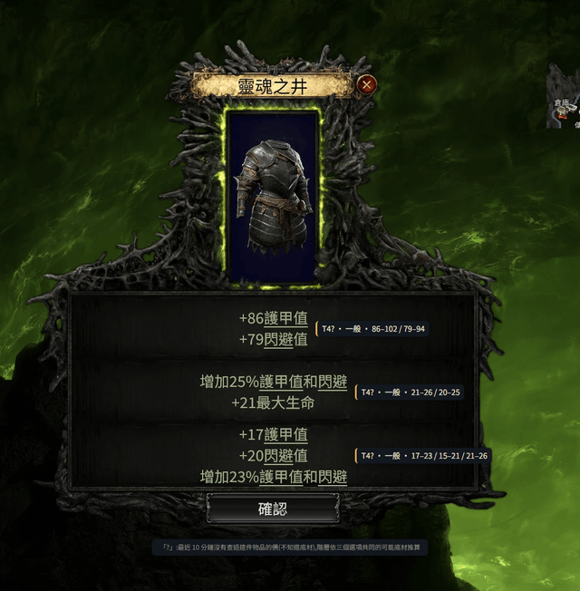
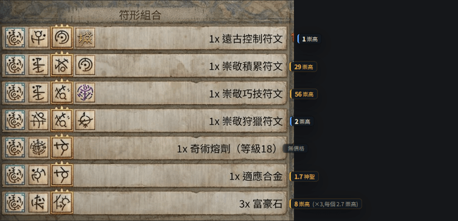

# ExileAppraiser(流亡鑑價)

[English](README.en.md) | **繁體中文**

Path of Exile 1 / 2 查價工具:在遊戲裡把滑鼠移到物品上按熱鍵,官方交易站的查價結果直接在游標旁彈出。支援國際服與台服、繁體中文與英文客戶端;另有懸浮選單、正則書籤、倉庫價格與畫面辨識等遊戲內小工具。

## 下載

僅支援 **Windows**。到 **[Releases 最新版](https://github.com/Hsiung-Shao/exile-appraiser/releases/latest)** 下載:

| 檔案 | 用途 |
|---|---|
| `ExileAppraiser-Setup-<版本>.exe` | **安裝版,建議下載。** 預設只為目前使用者安裝到使用者資料夾,不需要系統管理員權限,會建立捷徑(也可以自選安裝位置)。**只有安裝版會自動更新**:在背景下載新版,結束程式時套用;可在「設定 › 更新與關於」關閉。 |
| `ExileAppraiser-<版本>-portable.exe` | 免安裝版,雙擊直接執行。**不會自動更新**;有新版時「設定 › 更新與關於」會提示,按「前往 Releases」自行下載。 |
| `ExileAppraiser-Setup-<版本>.exe.blockmap` | 自動更新用(差分下載,只抓有變動的部分)。**不需要下載。** |
| `latest.yml` | 自動更新用(版本資訊與檔案雜湊驗證)。**不需要下載。** |
| Source code (zip / tar.gz) | GitHub 自動附上的原始碼。一般使用者不需要。 |

**Windows SmartScreen 提示**:本程式沒有程式碼簽章,第一次執行可能出現「Windows 已保護您的電腦」。確認檔案是從上面的 Releases 頁下載的,點 **「其他資訊」→「仍要執行」** 即可。

## 目錄

- [特色](#特色)
- [快速上手](#快速上手)
  - [1. 第一次啟動](#1-第一次啟動)
  - [2. 基本設定](#2-基本設定)
  - [3. 查價](#3-查價)
  - [4. 看懂查價面板](#4-看懂查價面板)
- [功能教學](#功能教學)
  - [懸浮選單](#懸浮選單)
  - [倉庫價格與倉庫價值(PoE1)](#倉庫價格與倉庫價值poe1)
  - [靈魂之井三選一辨識(PoE2)](#靈魂之井三選一辨識poe2)
  - [符文塑形自動查價(PoE2)](#符文塑形自動查價poe2)
  - [Poe Regex 搜尋字串與正則書籤](#poe-regex-搜尋字串與正則書籤)
  - [拆粉排行(PoE1)](#拆粉排行poe1)
  - [聊天指令、倉庫搜尋與倉庫頁籤捲動](#聊天指令倉庫搜尋與倉庫頁籤捲動)
  - [瀏覽器預覽設定](#瀏覽器預覽設定)
- [常見問題](#常見問題)
- [隱私](#隱私)
- [贊助與社群](#贊助與社群)
- [授權與致謝](#授權與致謝)

## 特色

**查價**

- **PoE1 與 PoE2 一支搞定**:依前景的遊戲視窗自動切換,不必手動改設定。
- **國際服 / 台服**:兩區交易站都能查;國際服會依複製出來的文字自動判斷中文或英文,遊戲換語言也能直接查。
- **遊戲內 overlay 查價**:查價面板疊在遊戲上、出現在游標旁;也可以改成獨立視窗模式。
- **查價面板**:詞綴與偽屬性分成兩張卡片,用開關與範圍膠囊調整;被合計吃掉的詞綴另列在「原始詞綴」卡;每條詞綴可選機制(不限 / 一般 / 破裂 / 工藝,PoE2 另有褻瀆 / 增幅)。
- **掛單結果**:可切換方塊 / 長條兩種顯示;滑鼠移到掛單上看完整物品(詞綴顯示繁中);掛單「在線」選單的離線、僅限商人、上架時間與通貨改了就一直沿用。
- **通貨價格區**:查通貨時頂端顯示 poe.ninja 兌換價、7 天走勢與每小時成交量,堆疊直接算總值。
- **相關物品**:查 Boss 碎片等物品時,旁邊列出同組物品與可換到的傳奇、命運卡價格(國際服)。
- **未鑑定傳奇**:先列出可能的傳奇讓你選,再查價。
- **PoE2 褻瀆詞綴 Tier**:查價時直接顯示遊戲給的 Tier;只有一般複製文字時依 PoB2 詞綴資料推定並標示「推定」。
- **拆粉(PoE1)**:查價面板顯示傳奇能拆出的粉塵量,另有全部傳奇的拆粉效率排行。

**遊戲內工具**

- **懸浮選單**:`Shift + Space` 叫出,一處集中匯率、倉庫本頁價值、自動辨識開關、正則書籤、速查表與設定。
- **Poe Regex 搜尋字串產生器**:勾選詞綴 / 名稱 / 數值,產生可貼進遊戲搜尋列的字串;支援多頁合併、分享碼、範本,書籤可分資料夾、設熱鍵、一鍵貼進遊戲。
- **聊天指令與倉庫搜尋熱鍵**:按一個鍵就輸入 `/hideout`、`@last ty` 等聊天指令,或把常用字串輸入倉庫搜尋框;按住 `Ctrl` 滾滑鼠滾輪切換倉庫頁籤。

**畫面辨識(OCR,只在本機執行)**

- **PoE1 倉庫價格與倉庫價值**:打開碎片頁的「一般」「聖甲蟲」子頁時,每格標上 poe.ninja 價格,並讀出堆疊數量算出本頁總價(國際服)。
- **PoE2 靈魂之井三選一辨識**:打開揭露面板就自動辨識,每個選項旁標出褻瀆詞綴的 Tier、詞綴池與數值範圍。
- **PoE2 符文塑形自動查價**:開著符文塑形面板時,每一列旁自動標出參考價;沒有 poe.ninja 價格的列自動查交易站。

**介面與維護**

- **介面語言另外切換**(中文 / English),與客戶端語言互不影響;四種主題、強調色與字級可調,設定視窗另有獨立字級;查價面板與設定視窗可換成自己的背景圖(亮度、面板不透明度、霧面、顯示位置可調)。
- **瀏覽器預覽設定**:用一般瀏覽器看、改設定,改動即時同步回 overlay。
- **自動更新與新版提醒**:安裝版在背景下載新版、結束程式時套用,之後只下載有變動的部分;有新版時右下角定期提醒,可略過該版。
- **啟動提示**:啟動後右下角短暫顯示「已在背景執行」與查價熱鍵,更新後顯示新版號。
- **一鍵回報**:無法辨識的詞綴旁、查價錯誤框都有回報按鈕,整理成 GitHub issue 草稿,由你確認後自己送出。
- **記錄頁**:設定 › 記錄可直接看程式的記錄(可篩選錯誤 / OCR / 查價 / 熱鍵、搜尋、複製),也能記錄效能資料方便回報。
- **匿名查詢**:不需要登入,也不需要 POESESSID。

## 快速上手

### 1. 第一次啟動

- 程式啟動後在背景執行,沒有主視窗。螢幕右下角會短暫顯示「流亡鑑價 已在背景執行」與查價熱鍵(可在「設定 › 一般」關閉這個提示)。
- 程式圖示在 **系統匣**(工作列右下角)。右鍵選單只有:在瀏覽器開啟設定、版本(灰字,不可點)、檢查更新、結束;雙擊圖示可叫出設定視窗。
- 開啟設定的方式:
  - 雙擊系統匣圖示(或右鍵 →「在瀏覽器開啟設定」用瀏覽器開);
  - 遊戲中沒有開著查價面板時按 **`Shift + Space`** 叫出[懸浮選單](#懸浮選單),點「設定」;
  - 查價面板標題列的齒輪 ⚙。
- 設定視窗左側選單分成兩組:

| 組 | 分頁 | 內容 |
|---|---|---|
| 設定 | 一般 | 介面語言、主題、字級、背景圖、啟動提示、硬體加速、瀏覽器預覽 |
| | 遊戲 | 遊戲、伺服器、客戶端語言、聯盟、交易站驗證、遊戲視窗標題、自動切換、overlay 模式 |
| | 查價 | 詞綴數值容差、預設價格通貨、面板顯示、掛單與剪貼簿 |
| | 倉庫與聊天 | 倉庫搜尋、倉庫頁籤捲動、聊天指令 |
| | 熱鍵 | 所有熱鍵的總表(重複或被佔用時即時標示) |
| | 更新與關於 | 自動更新、新版提醒、開啟設定資料夾、支援的遊戲版本 |
| 工具 | 自動辨識 | OCR 共用設定、倉庫價格(PoE1)、褻瀆詞綴 / 符文塑形(PoE2)、徽章外觀 |
| | 正則 | Poe Regex 搜尋字串產生器與書籤 |
| | 拆粉排行 | 全部傳奇的拆粉效率(PoE1) |
| | 記錄 | 程式記錄與效能記錄 |

### 2. 基本設定

<!-- 補圖:docs/images/settings-game.png(設定 › 遊戲 分頁) -->

在 **設定 › 遊戲**:

1. **遊戲**:PoE1 / PoE2。預設會依前景的遊戲視窗自動切換(同一頁的「自動切換 PoE1 / PoE2」)。
2. **伺服器**:國際服(`pathofexile.com`)或台服(`pathofexile.tw`)。台服目前只支援繁體中文客戶端。
3. **客戶端語言**:你的**遊戲**是繁體中文還是英文。**國際服**查價會自動依複製出來的文字判斷語言(遊戲換成另一種語言也能直接查,結果相同),這個設定是預設值;**台服**一律照這個設定(台服只支援繁體中文,選錯會解析失敗)。OCR(倉庫 / 褻瀆 / 符文塑形)的辨識語言也預設跟著它。
4. **聯盟**:選你要查價的聯盟(查價面板標題列與懸浮選單也能切換)。清單載不出來時,在同一頁「交易站驗證」按「開啟驗證視窗」,在跳出的視窗完成一次 Cloudflare 驗證。

程式本身的顯示語言(繁體中文 / English)在 **設定 › 一般** 的「介面語言」。設定變更會自動儲存。

### 3. 查價

<!-- 補圖:docs/images/settings-hotkeys.png(設定 › 熱鍵 總表,取代舊圖) -->

預設熱鍵(都可在 **設定 › 熱鍵** 修改:點一下欄位後直接按下新的組合鍵,`Esc` / `Backspace` 清除):

| 熱鍵 | 預設 | 作用 |
|---|---|---|
| 快速查價 | `Ctrl + D` | 按住 `Ctrl` 再按 `D`,面板出現在游標旁。**繼續按住 `Ctrl`** 把滑鼠移進面板就能操作;放開 `Ctrl` 後把滑鼠移開,面板自動關閉。 |
| 鎖定查價 | `Ctrl + Alt + D` | 面板可以直接點擊,不會因為移動滑鼠而關閉,適合慢慢調整篩選。 |
| 設定選單 | `Shift + Space` | 開著查價面板時在遊戲與 overlay 之間切換焦點;沒有查價面板時叫出 / 收起[懸浮選單](#懸浮選單)。 |
| 褻瀆辨識:暫停 / 繼續 | `Ctrl + Shift + R` | PoE2 靈魂之井自動辨識的暫停與繼續。 |

其他熱鍵(符文塑形、倉庫價格、正則快速面板、各書籤、倉庫搜尋)預設未設定,需要時再到同一頁指定;未設定的顯示灰字,紅字表示衝突或無法註冊。

步驟:

1. 遊戲視窗在前景時,滑鼠移到物品上按查價熱鍵。程式會替你送出複製鍵讀取物品文字:
   - **PoE1**:送出 `Ctrl + C`。
   - **PoE2**:送出 `Ctrl + Alt + C`(進階複製),才拿得到遊戲給的褻瀆詞綴 Tier。目前以遊戲預設的 `Alt` 當作「顯示進階說明」鍵;若你在遊戲裡改過這個鍵,暫不支援。
2. 面板列出物品的詞綴篩選:**勾選**要納入搜尋的詞綴、調整數值範圍(預設容差在「設定 › 查價」)。
3. 傳奇、通貨等物品會直接開始查詢;其他物品調整好篩選後按 **「搜尋」**。
4. 想在網頁上看完整結果,按 **「交易」** 會用系統瀏覽器開啟交易站的同一個搜尋。

> 也可以手動貼上:查價面板沒有物品時(或按面板下方的「貼上另一件」),把物品文字(遊戲中 `Ctrl + C` 複製的內容)貼進去按「解析」。

### 4. 看懂查價面板

<!-- 補圖:docs/images/price-panel.png(查價面板:詞綴卡 + 掛單) -->

- **詞綴 / 偽屬性卡片**:每條詞綴用開關決定要不要納入搜尋,範圍膠囊調整數值上下限。
- **原始詞綴卡**:被偽屬性、護甲 / 閃避等合計吃掉的詞綴與符文詞綴都列在這裡,預設收起、不勾選;要單獨查某條時再展開勾選。
- **詞綴機制**:按面板底部的「機制」開關,可選機制的詞綴下方出現機制按鈕(關著時只有改過機制的詞綴會顯示):
  - **不限**(預設):不管這條詞綴是一般、破裂還是工藝,都算數。
  - **一般**:排除這條詞綴本身那種機制的物品(例:這條是工藝詞綴,選一般就不找這條由工藝做出來的物品)。
  - **破裂 / 工藝**(PoE2 另有 **褻瀆 / 增幅**):只找這條同樣是該機制的物品。
- **通貨價格區**:查通貨時頂端顯示 poe.ninja 兌換價、7 天走勢與每小時成交量(國際服);有價值的底材會標「底材」。
- **掛單**:標題列的「方塊 / 長條」切換顯示方式,物品與通貨各自記住。滑鼠移到掛單上可看完整物品(「設定 › 查價 › 滑鼠懸停顯示物品」可選關閉 / SHIFT + 懸停 / 始終懸停顯示)。
- **相關物品**:查 Boss 碎片等物品時,面板旁列出同組物品與可換到的傳奇、命運卡等物品價格(國際服;大小在「設定 › 查價」調整)。
- **未鑑定傳奇**:會先列出可能的傳奇讓你選(只有一件時自動選定),再查價。
- **回報問題**:無法辨識的詞綴旁有「回報這條」,詞綴清單上方會提示有幾條無法辨識;查價失敗或物品無法解析時也有回報按鈕。程式會整理成 GitHub issue 草稿(不會自動送出、不含帳號名)。也可以到 **設定 › 記錄** 按「複製目前篩選結果」把相關記錄貼進 issue。

**掛單卡的「在線」選單**

<!-- 補圖:docs/images/online-filter.png(掛單卡「在線」選單展開) -->

點掛單卡標題列上顯示目前掛單條件的按鈕(例如「在線」)打開選單,可以改:

- **離線與在線**、**僅限商人**(PoE2 合併成一組掛單類型選項,一般查價與大宗查價分開記)
- **上架時間**(任何時間 ~ 至多 2 個月前)
- **通貨**(任何通貨 / 混沌石 / 神聖石 / 兩種都可;PoE2 另有崇高石)

這些選擇**會自動記住**:換一件物品、重開程式都沿用最後一次的設定(PoE1 的通貨也會同步到「設定 › 查價 › 預設價格通貨」)。聯盟不在記住範圍,一律以標題列為準。選了「包含離線」或較短的上架時間後會一直沿用,不需要時記得改回來。

其他查價選項在 **設定 › 查價**:詞綴數值容差、預設價格通貨(只有 PoE1)、API 延遲補償、通貨每小時成交量(國際服)、相關物品大小、滑鼠懸停顯示物品、顯示賣家、帳號名稱(用來標記自己的掛單,可留空)、查價後還原剪貼簿。

## 功能教學

### 懸浮選單

<!-- 補圖:docs/images/float-menu.png(Shift + Space 叫出的懸浮選單) -->

overlay 模式下,遊戲中沒有開著查價面板時按 **`Shift + Space`**,畫面上出現懸浮選單:

- **標題列**:切換聯盟、顯示交易站查詢限流狀態;拖曳標題列可移動選單,位置會記住。
- **搜尋框與分類**:輸入文字找功能或書籤;分類有 全部 / 書籤 / 辨識 / 工具,`↑` `↓` 選擇、`Enter` 執行。
- **市況**:1 神聖石 = 多少混沌石(PoE1)/ 崇高石(PoE2)與 7 天走勢(國際服,查過一次價後才有資料)。
- **倉庫本頁價值**(PoE1):開著倉庫碎片頁時顯示本頁總價;選單開著時可以拖曳畫面上的價值卡,選單裡可「還原位置」。
- **自動辨識開關**:依目前遊戲列出倉庫價格(PoE1)或褻瀆辨識 / 符文塑形(PoE2)的開關。
- **正則書籤**:可切換 PoE1 / PoE2,依資料夾分組、每列顯示字串內容;目前遊戲的書籤點一下就貼進遊戲搜尋列,另一款遊戲的只複製。
- **工具**:設定、速查表、拆粉排行。
- **速查表**:內建一張密教速查表,滑鼠移上去暫時放大、點一下釘住(釘住後可移動、調整大小);也可以「匯入自己的圖…」,或「還原內建」。

按 ✕、點選單外面、`Esc` 或再按一次 `Shift + Space` 收起;查價面板出現時也會自動收起。

### 倉庫價格與倉庫價值(PoE1)

<!-- 補圖:docs/images/stash-prices.png(碎片頁每格價格徽章 + 本頁價值卡) -->

打開倉庫**碎片頁**的「一般」「聖甲蟲」子頁時,每一格直接標上 poe.ninja 價格(C = 混沌石、D = 神聖石);滑鼠停在某一格時只放大那一格。

**條件**:PoE1、overlay 模式、國際服(台服沒有 poe.ninja 價格,只顯示物品名稱)。設定在 **設定 › 自動辨識 › 倉庫價格(PoE1 碎片頁)**,預設開啟。

- **倉庫價值**:讀出每格的堆疊數量,徽章改顯示小計,畫面上另有「本頁價值」卡。讀不到數量的格子標「?」、沒有價格的標「無價」,都不計入總價。數量是畫面辨識,可能讀錯,請以遊戲內為準。
- **顯示方式**:「自動偵測」(打開倉庫就自動出現)或「按熱鍵顯示」(平常完全不截圖,按「倉庫價格:啟動 / 暫停」熱鍵才辨識,關倉庫自動收起)。熱鍵在「設定 › 熱鍵」設定。
- **徽章顯示物品名稱**:用來確認每格辨識的物品對不對;確認後可以關掉,只留價格。
- **OCR 區域**:格子位置依固定版面推算;非 16:9 或特殊解析度對不準時,可在遊戲上框選子頁按鈕列校正,或「還原預設」。
- 徽章的字體、大小與價格分段顏色在同一頁的「徽章外觀」調整。

### 靈魂之井三選一辨識(PoE2)

靈魂之井的三選一揭露面板無法複製文字,所以改用 Windows 內建的文字辨識(OCR)讀畫面。

**條件**:PoE2、overlay 模式、**繁體中文或英文遊戲客戶端**,並已安裝對應的 Windows OCR 語言包:繁體中文遊戲用**繁中(zh-Hant-TW)**、英文遊戲用**英文(en-US)**。辨識語言預設跟隨客戶端語言;介面是繁中、遊戲是英文時,可在「設定 › 自動辨識」共用設定的「辨識語言」改選 English(與介面語言、客戶端語言各自獨立,倉庫、褻瀆與符文塑形共用)。

**安裝 OCR 語言包**(只需一次;英文版 Windows 通常已內建英文語言包):

1. Windows 設定 → **時間與語言** → **語言與地區**。
2. 在「中文(台灣)」(英文客戶端:「英文(美國)」)點 **⋯ → 語言選項**(清單裡沒有就先「新增語言」加入)。
3. 在「光學字元辨識」按 **下載**。
4. 回到程式的 **設定 › 自動辨識**,共用設定的「OCR 狀態」顯示「可用(zh-Hant-TW)」或「可用(en-US)」即可(可按「重新檢查」)。

**使用**:

1. 打開靈魂之井三選一畫面,程式會自動辨識(預設開啟,可在「設定 › 自動辨識 › 褻瀆詞綴」關閉)。
2. 每個選項右側出現 `Tier · 詞綴池 · 數值範圍` 的徽章;開著查價面板時也會照常辨識。
3. 關掉揭露面板徽章就消失。**`Ctrl + Shift + R`** 暫停 / 繼續自動辨識(按下時右下角會提示目前狀態)。

- 徽章出現 **「?」**:最近 10 分鐘內沒有查過這件物品的價,程式不知道底材,只能依三個選項共同可能的底材推算。**先對物品查一次價再開揭露面板**,結果會更精確。
- **框選辨識區域(可選)**:在「設定 › 自動辨識 › 褻瀆詞綴」按「在遊戲上框選」,在遊戲畫面上拖曳框出揭露面板,`Enter` 確認、`Esc` 取消。框了區域就只看這一塊(較快、較準);區域內沒找到面板時會顯示「區域內沒找到面板」,請重新框選或清除。
- **設定**(倉庫、褻瀆與符文塑形三張卡片的項目相同):啟用、目前狀態、掃描間隔(預設 1000 ms,可設 100–3000;低於 500 ms 較吃 CPU)、辨識區域;褻瀆另有「一個選項有多個可能詞綴時全部列出」。

### 符文塑形自動查價(PoE2)

開著符文塑形面板時,程式定時辨識面板,在每一列右側標出 poe.ninja 參考價。只截圖 + 本機 OCR,不送任何按鍵。

**條件**:PoE2、overlay 模式、繁體中文或英文遊戲客戶端、已安裝對應的 OCR 語言包(步驟同上)。poe.ninja 參考價只有**國際服**;台服改為自動查台服交易站(見下面的「自動查市集」)。

**開啟**:設定 › 自動辨識 › 符文塑形 → 打開「自動查價」(預設關閉)。

- **面板區域**:不框選時自動尋找面板(約每 3 秒看一次整個畫面,找到後只掃面板那一塊)。辨識不穩時可手動框選,框住面板上所有物品列(含數量)。手動區域內找不到面板時**不會**自動改掃整個畫面,請重新框選或清除區域。
- **掃描間隔**:預設 1000 ms(可設 100–3000;低於 500 ms 會明顯吃 CPU)。覺得吃 CPU 就調大。查價面板、設定或框選層開著、或遊戲不在前景時自動暫停。
- **暫停 / 繼續熱鍵**、**框選區域熱鍵**:預設未設定,可在「設定 › 熱鍵」指定。

**怎麼看徽章**:

| 徽章 | 意思 |
|---|---|
| `29 崇高`、`1.7 神聖` | 參考價。以崇高石計,滿 1 神聖石改用神聖石;數量大於 1 時顯示總價與單價。 |
| 金色 | 總價 ≥「高於」門檻(預設 5 崇高)。 |
| 強調色左框 | 介於兩個門檻之間。 |
| 暗色 | 總價 <「低於」門檻(預設 0.5 崇高)。兩個門檻都能在「設定 › 自動辨識 › 徽章外觀」改。 |
| 名稱前的 `≈` | 名稱是模糊比對到的,可能不準。 |
| **無價格** | 是具體物品,但 poe.ninja 沒有價格,而且查不了交易站(例如還沒選聯盟)。查得了的會改顯示下面的「市」。 |
| **無固定價格**(虛線、斜體) | 泛稱獎勵,例如「維里西姆堆」、隨機通貨、某部位的任一傳奇,本來就沒有單一市價。 |
| `市 80 崇高 · L20`(藍色左框) | 自動查到的交易站價格(最便宜 10 筆的中位數;不到 3 筆顯示最低價並標「少」)。`·` 後面是關鍵篩選:`L20` = 寶石等級 20、`等級不限` = 面板沒寫等級。 |
| `市 …` / `市 查詢中` | 排隊中 / 正在查交易站。 |
| `?` | 對不上物品名稱(或同名有多個候選),不查價。 |
| (沒有徽章)「未發現」 | 尚未解鎖的配方,不標。 |

**自動查市集**:沒有 poe.ninja 價的列(例如技能寶石、沒收錄的等級;台服是全部)會自動排隊查交易站,不必點。
寶石一律帶**未汙染、品質 0**,面板寫了等級(`技能等級 20：…`)就只查該等級,避免被高規格掛單誤導;完整篩選寫在程式記錄裡。
一次只查一筆、每筆最多 1 次搜尋 + 1 次取明細;同一組篩選 30 分鐘內不重查。為了**不影響平常的查價**:交易站限流額度不夠時自動延後、查價面板或設定開著時暫停、交易站回 429 時整個佇列停到解除;面板關掉就清掉還沒送出的查詢。台服以掛單原幣顯示。

### Poe Regex 搜尋字串與正則書籤

<!-- 補圖:docs/images/regex.png(設定 › 正則,含書籤卡片) -->

在 **設定 › 正則**。

1. 上方選遊戲與清單(PoE1:地圖、探險日誌、聖甲蟲、藥劑、星團珠寶、技能寶石、紋身與符文之結、劫盜裝備、劫盜契約書、物品基底;PoE2:換界石、碑牌、聖物、探險遺物、藥劑與護符、技能寶石、物品基底;兩代另有「物品詞綴數值」與「商店 / 物品條件」頁)。
2. 勾選想找的詞綴 / 名稱;數值條件可設「≥ / ≤ / 區間」:
   - 地圖 / 換界石詞綴頁頂端有數值區(地圖階級、物品數量等),與詞綴合成同一條正則;
   - 「物品詞綴數值」頁可搜尋詞綴並設定數值,例如最大生命 ≥ 80(只支援單一數值的詞綴);
   - 地圖、換界石、物品基底、商店、物品詞綴數值、碑牌詞綴等頁可加 **稀有度**(普通 / 魔法 / 稀有 / 傳奇,可複選)與 **汙染**(未汙染 / 已汙染)條件。
3. 選模式:**含任一個** / **全部都有** / **一個都沒有**(排除字串)。
4. 選輸出語言(**繁體中文 / English**,必須和你的遊戲客戶端一致)。
5. 按「複製」,貼進遊戲的搜尋列(倉庫、商店等)。

- **合併**:各頁勾選合成一串,會檢查跨頁誤中與長度上限;不同類物品的頁不會合成同一條。
- **分享碼**:整組勾選壓成一串分享碼給別人,貼上即還原。
- **範本**:內建常用組合(例如 T17 危險詞綴、地圖無反射、6L 商店、換界石危險詞綴)。
- **從 PobTools 送正則**:PobTools 可一鍵把選好的正則書籤或目前的勾選送進來,確認後才加入(需要 PobTools 對應版本)。

**正則書籤**:

<!-- 補圖:docs/images/regex-bookmark-bar.png(設定視窗旁的書籤列,或快速面板) -->

- 把常用的一組勾選存成書籤,之後一鍵載入;書籤分 PoE1 / PoE2 兩頁,可建資料夾、拖曳排序。
- **一鍵貼進遊戲**:點書籤會複製並貼進遊戲搜尋列(`Ctrl + F` → 貼上 → `Enter`),需先開著倉庫或商店。可以從這三個地方用:
  - **書籤列**:打開設定時,設定視窗旁列出書籤(「設定 › 正則 › 書籤快捷存取」可關閉);
  - **快速面板**:指定「快速面板熱鍵」後按下叫出書籤清單,`↑` `↓` 或數字鍵 1–9 選了就貼;
  - **書籤熱鍵**:每個書籤可設自己的熱鍵,按下直接貼;[懸浮選單](#懸浮選單)的書籤區也能點。
- 「加到倉庫搜尋」可把目前的字串存成[倉庫搜尋](#聊天指令倉庫搜尋與倉庫頁籤捲動)項目。

### 拆粉排行(PoE1)

<!-- 補圖:docs/images/dust-ranking.png(設定 › 拆粉排行,取代舊圖) -->

- 對傳奇物品查價時,面板會顯示這件能拆出多少粉塵;有 poe.ninja 價格時換算成每混沌石幾粉塵。
- **拆粉排行**在設定視窗的「拆粉排行」分頁(查價面板標題列的 ⚖ 與懸浮選單也會開到這裡)。列出所有傳奇,可依「粉塵 / c」「粉塵 / 總成本」「粉塵 / gold」「粉塵 / c / 格」排序,並考慮物品等級、品質、飾品催化劑、gold 手續費與固有勢力。
- 每列的「交易 ↗」「ninja ↗」會用**系統瀏覽器**開啟交易站搜尋或 poe.ninja 頁面。
- 價格來自 poe.ninja,**只有國際服**;台服只顯示粉塵量。

### 聊天指令、倉庫搜尋與倉庫頁籤捲動

都在 **設定 › 倉庫與聊天**。

- **聊天指令**:預設 `F5` = `/hideout`(回藏身處)、`F9` = `/exit`;`@last ty`、`/invite @last` 等可自行指定熱鍵。`@last` = 最後一個私訊你的人;沒勾「直接送出」時只貼進聊天框,讓你改完再按 Enter。
- **倉庫搜尋**:按熱鍵把字串輸入倉庫搜尋框。可在「正則」分頁按「加到倉庫搜尋」直接帶入。
- **倉庫頁籤捲動**:在遊戲裡按住 `Ctrl` 滾動滑鼠滾輪切換倉庫頁籤(預設開啟,可改為停用)。
- 熱鍵只在疊加模式、遊戲視窗在前景時有效;遊戲自己會用到的按鍵(`Ctrl + C`、`Enter` 等)不能當熱鍵。
- 這些功能會透過剪貼簿貼上文字並對遊戲送出按鍵(與 Awakened PoE Trade 相同做法)。

### 瀏覽器預覽設定

- 系統匣選單或「設定 › 一般」的「在瀏覽器開啟設定」,用一般瀏覽器看、改設定,改動即時套用回程式。
- 只在本機開放(`127.0.0.1` + 隨機金鑰),別台電腦開不起來。最後一個瀏覽器分頁關閉 20 秒後自動關閉。
- 在瀏覽器裡改遊戲、overlay 模式或視窗標題,要下次啟動程式才生效。

## 常見問題

<b>按熱鍵沒反應 / overlay 沒有出現在遊戲上</b>

- 遊戲請使用 **無邊框視窗** 或 **視窗模式**。全螢幕獨占模式下 overlay 可能蓋不上去,OCR 也可能擷取到黑畫面。
- overlay 模式只在遊戲視窗位於前景時作用。確認「設定 › 遊戲」的「PoE1 / PoE2 遊戲視窗標題」與遊戲視窗標題相符(預設 `Path of Exile` / `Path of Exile 2`)。
- 熱鍵被其他程式佔用時,「設定 › 熱鍵」會標成紅字,請換一組按鍵。
- 不想用 overlay,可以在「設定 › 遊戲」取消「疊加在遊戲上」改用獨立視窗(會自動重新啟動)。
- 程式剛開、遊戲後開時,最慢約 12 秒才會偵測到遊戲。

<b>聯盟清單載不出來 / 交易站出現驗證頁</b>

交易站前面有 Cloudflare 防護。到「設定 › 遊戲」的「交易站驗證」按 **「開啟驗證視窗」**(或在查價面板的錯誤訊息按「開啟交易站(解除驗證)」),在跳出的視窗完成一次驗證後再按「重試」。

若顯示「限流中」,是交易站的查詢頻率限制,程式會在倒數結束後自動重試;懸浮選單標題列也會顯示限流狀態。

<b>每次查價都帶著「包含離線」或某個上架時間 / 通貨</b>

掛單卡的「在線」選單會記住你最後一次的選擇(見[看懂查價面板](#4-看懂查價面板))。打開選單改回想要的設定即可,之後就沿用新的選擇。

<b>OCR 認不出來 / 找不到面板</b>

- 先確認「設定 › 自動辨識」的「OCR 狀態」為「可用」;缺語言包請照[上面的步驟](#靈魂之井三選一辨識poe2)安裝。
- 遊戲 UI 亮度太低會影響辨識。
- 用框選功能把辨識範圍縮小到面板上,通常更快也更準;面板位置變了(換解析度、UI 縮放)就重新框選。
- 支援繁體中文與英文遊戲客戶端;OCR 用哪個語言包由「設定 › 自動辨識」的「辨識語言」決定(預設跟隨客戶端語言,可手動指定繁體中文 / English,要和遊戲畫面實際語言一致)。
- 符文塑形面板整頁都是泛稱的分頁(例如英文客戶端 Uniques 分頁的 `Unique Ring`、`Rare Unique Item`,沒有 `1x` 之類的前綴)目前不會出徽章(繁中 / 英文相同;泛稱本來就不查價)。
- 倉庫價格對不準格子時,在「設定 › 自動辨識 › 倉庫價格」框選 OCR 區域校正。回報倉庫辨識問題時,可在「設定 › 記錄」按「存下倉庫擷取畫面」,把程式實際看到的畫面一起附上。

<b>台服和國際服有什麼不同?</b>

- 台服查詢 `pathofexile.tw`,目前只支援繁體中文客戶端。
- poe.ninja 沒有台服價格,因此台服沒有:拆粉價格(只顯示粉塵量)、通貨價格區、相關物品、懸浮選單的匯率、倉庫價格(只顯示物品名稱);符文塑形徽章沒有參考價,改為自動查台服交易站(原幣顯示)。

<b>設定存在哪裡?</b>

設定變更會自動儲存,存在 `%APPDATA%\exile-appraiser\config.json`。「設定 › 更新與關於」的「開啟設定資料夾」可以直接打開這個資料夾。

<b>怎麼關閉自動更新或新版提醒?</b>

「設定 › 更新與關於」→ 取消「自動更新」。關閉後有新版時需要自己按「下載」,下載完成後按「重新啟動並安裝」。免安裝版本來就不會自動更新。

有新版時右下角會出現提醒(約每 10 分鐘一次),可以選立即更新、稍後或略過此版本;不想看到提醒,取消同一頁的「有新版本時定期提醒」。

## 隱私

- **OCR 在本機執行**:倉庫價格、褻瀆與符文塑形辨識都使用 Windows 內建的文字辨識,截圖不存檔、不上傳,辨識時也不會對遊戲送出任何按鍵。只有你在「設定 › 記錄」按「存下倉庫擷取畫面」時,才會把一次擷取存到本機的記錄資料夾。
- **匿名查詢**:只向官方交易站與 poe.ninja 發出匿名查詢,不需要登入、不需要 POESESSID。
- **回報由你決定**:「回報」只會開啟預填好的 GitHub issue 頁面,內容由你確認後自己送出。
- **記錄只存本機**:程式記錄(設定 › 記錄)只放在這台電腦的資料夾裡(`%APPDATA%\exile-appraiser\logs`,保留 7 天),不會自動上傳;要回報問題時由你自己複製貼上。

## 贊助與社群

如果這個工具對你有幫助,歡迎支持 **本專案(ExileAppraiser)的維護者**。這些連結贊助的是本專案的維護工作,不是下方致謝中的 Awakened PoE Trade / Exiled Exchange 2 原作者;支持原作者請見[授權與致謝](#授權與致謝)。

- Buy Me a Coffee:https://buymeacoffee.com/hsiung
- Patreon:https://patreon.com/HsiungShao
- Discord(PoE 身分組):https://discord.gg/6VamPQb8nC
- 個人網站:https://hsiung-shao.github.io/

問題回報與建議請到 [GitHub Issues](https://github.com/Hsiung-Shao/exile-appraiser/issues)。

## 授權與致謝

本專案以 [MIT 授權](LICENSE) 釋出。

本工具建立在以下專案之上,也請考慮支持原作者:

- [Awakened PoE Trade](https://github.com/SnosMe/awakened-poe-trade)(SnosMe,MIT):PoE1 剪貼簿解析、篩選器、交易查詢與資料檔(經由繁中 fork [awakened-poe-trade-zh-TW](https://github.com/Hsiung-Shao/awakened-poe-trade-zh-TW))。支持原作者:https://patreon.com/awakened_poe_trade
- [Exiled Exchange 2](https://github.com/Kvan7/Exiled-Exchange-2)(Kvan7,MIT):PoE2 剪貼簿解析、篩選器、交易查詢、資料檔與圖示(經由繁中版 [Exiled-Exchange-2-zh-TW](https://github.com/Hsiung-Shao/Exiled-Exchange-2-zh-TW))。
- [poe-disenchant-tool](https://github.com/deronek/poe-disenchant-tool)(deronek,MIT)與 [@alserom](https://gist.github.com/alserom/22bdd4106806cbd4f85a5cb8c4345c08) 整理的 poe-dust 資料:拆粉的 gold 手續費、背包格數與交叉比對數值。
- [Exile UI](https://github.com/Lailloken/Exile-UI)(Lailloken,MIT):PoE1 倉庫價格的固定版面座標與格子換算規則(Stash-Ninja)。

內建的密教速查表圖片來自 [elrincondelexiliado.com](https://pathofexile.elrincondelexiliado.com/syndicate)。其他第三方元件的授權聲明見 [`NOTICE.md`](NOTICE.md) 與 [`LICENSES/`](LICENSES/)。

Path of Exile、遊戲內名詞、物品與相關資料為 Grinding Gear Games 所有。本專案與 Grinding Gear Games 無關,亦未獲其背書。
